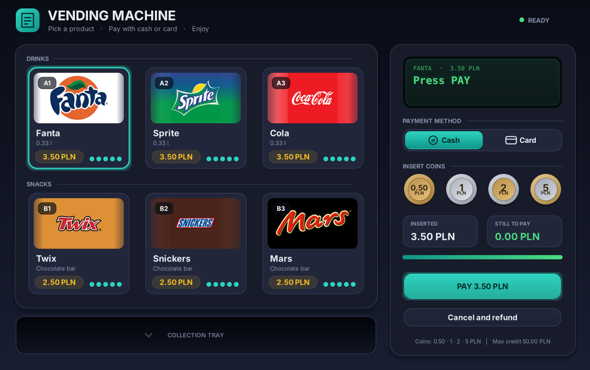

# Vending Machine (Windows Forms, C#)

A vending machine simulator: pick a drink or a chocolate bar, pay with coins or a contactless card, collect the product and the change (or donate the change).



## Features
- 6 products with stock (5 per slot) and a "sold out" state
- Cash: 0.50 / 1 / 2 / 5 PLN coins, progress bar, change returned as the fewest coins, optional donation of the change
- Card: simulated contactless reader (authorizing, approved)
- Cancel and refund (button or Esc); switching to card refunds coins
- Keyboard support (Tab, Enter/Space, arrows)
- Business logic separated from the UI and covered by 28 tests

## Structure
```
VendingMachine/Logic   rules, products, money (no UI code)
VendingMachine/UI      main form and custom-drawn controls
tests/LogicTests.cs    dependency-free test runner
Documentation.docx     user documentation and bug report
```

## Build and run
Visual Studio 2019+: open `VendingMachine.sln`, press F5. Target: .NET Framework 4.7.2.

Tests (Mono or .NET Framework compiler):
```
cd tests
mcs -out:LogicTests.exe LogicTests.cs ../VendingMachine/Logic/*.cs && mono LogicTests.exe
```

## History
Rewrite of a university project (original in Polish): bugs fixed (lost first coin, crash on empty payment, credit leaking between sales, float money, no cancel/refund), new interface, English texts. See section 4 of `Documentation.docx`.
